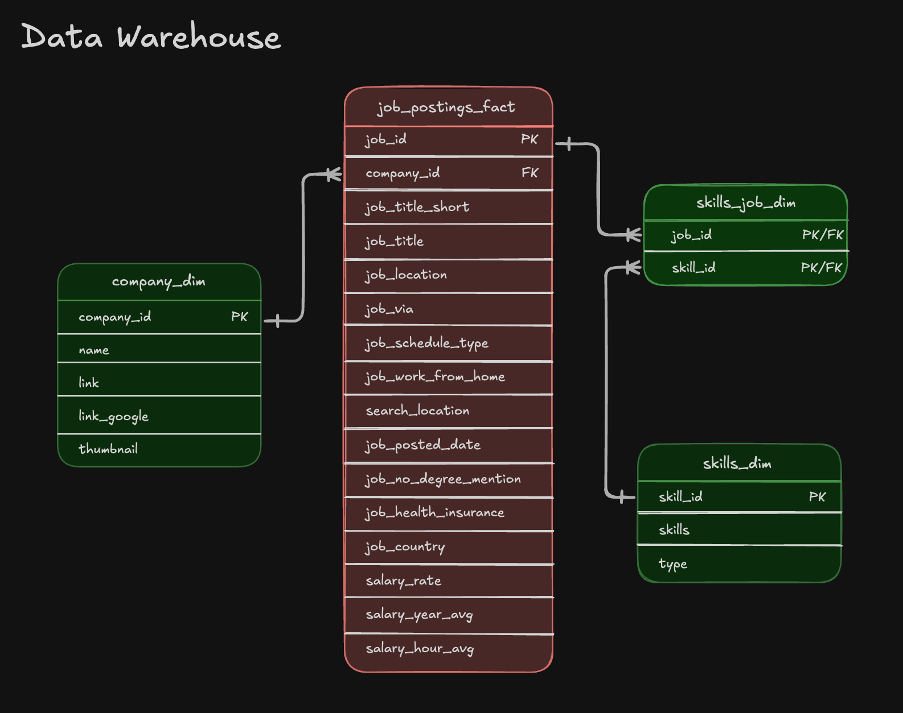

# Exploratory Data Analysis w/ sql : Job market analysis

This is a Sql project analyzing the Data Engineer job market using real data world job posting data. 
**it demonstrates my ability to write my ability to write production quality analytical SQL design efficient queries and trun business question into Data-driven insights** 

## Executive summary
#### Project Scope: 
- Build 2 analytical querise that answer key question about Data Enginneer job market
#### DATA Modeling 
- used multi table  joins to extract insights
#### Analytics 
- Applied aggregation filtering and shorting to finds top skills by demand and and salary   
#### Outcomes 
- Dlivered actionable insight on SQL/PYTHON, CLOUD trends and salary patterns

**Feel free to check it out:**
  - [Top Demanded Skilss](../projects/top_demanded_skills.sql)

 - [Top Paying Skills](top_paying_skills.sql)
 - [Most optimal skills](../projects/Most_optimal_skills.sql)

## Problem and Contex 
- Job market analyst need to answer like:
    - Top demanded skill
     - Top Paying Skill
- This project analyzes a **Date warehouse** build using a star schema design.The warehouse structure consistes of  

- Fact table **'job_posting_fact'** is this main table contaning the titles,loctions and salary
- #### Dimension Table 
    - **company_dim**
    - **skills_dim**
- #### Bridge Table 
    - **skills_job_dim** 

By querying across these interconnected tables,extracted insights about skills demand, salary combination for Data Engineering roles 
    
## Tech Stack
- **Language:** SQL
- **Development:** VS code 
- **Version Control:** Git/Git for versioned SQL scripts
## Analysis Overview 
- [Top Demanded Skills](../projects/top_demanded_skills.sql) : It identiifies the top most in demand skills for Data Engineer in India
- [Top Paying skills](../projects/top_paying_skills.sql) : it identifies top paying skills for Data Engineer in India
## SQL skill demonstrated 

- ### Query design and & optimization
  - **Complex Joins:** multi table inner join across 'job_bosting_fact' 'skill_job_dim' and 'skilss_dim'
  - **Aggregations:** count(),round(),sum() for statistical analysis 
  - **Filtering:** Boolean logic with 'where' clauses and multipel conditions like 'job_country' and 'job_title_sort'
  - **Sorting and Limitings:** used 'order by' with desc and limit for ton n anlysis  
  - **CTEs** Used CTEs most_optimal_skills query. Made two CTEs and joined theem for msot optimal skills 
  ### Data analysis techniques
  - **Grouping** 'Grouping by' for categorical analysis by skill 
  - **mathematical Functioons:** Proper filtering for   incomplete record ('salary_year_avg is not null')
### Conclusion  
      

    Through this project, I strengthened my SQL skills and gained practical experience in analyzing real-world job market data. By using complex joins, aggregations, filtering, sorting, and CTEs, I identified the most in-demand and highest-paying skills for Data Engineer roles in India.

    The analysis helped me understand how technical skills influence job opportunities and salary potential. It also highlighted the importance of focusing on skills that offer a strong balance between market demand and earning potential.

    **Key Takeaway:** Data-driven insights can help aspiring Data Engineers make smarter career decisions and prioritize the right technical skills for long-term growth.

    This project represents another step forward in my journey toward becoming a Data Analyst.
